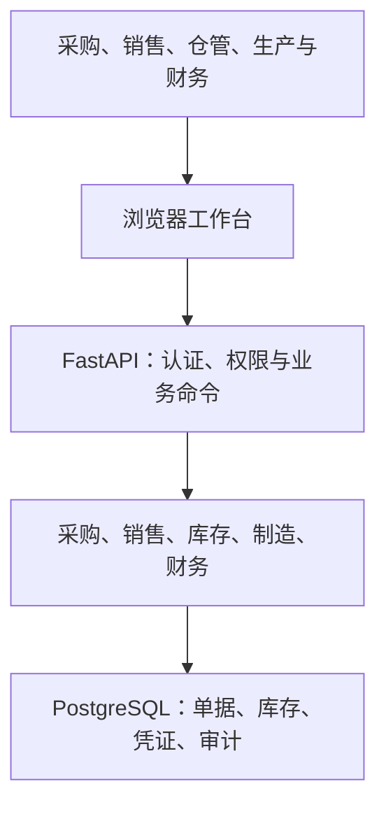
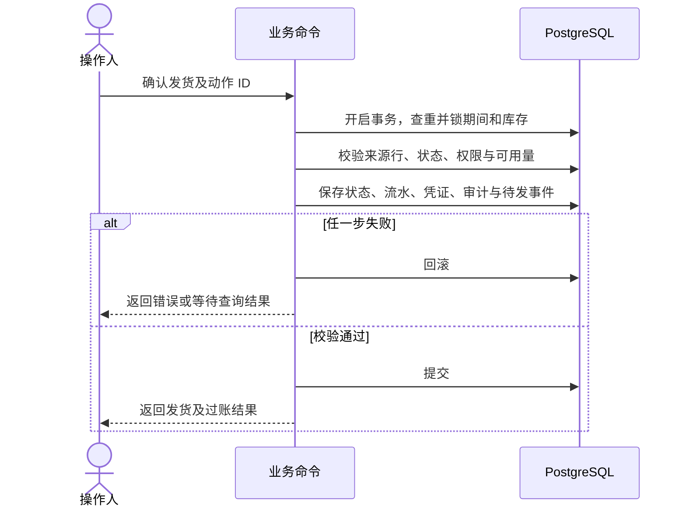

# 衡序 ERP 架构与技术实现文档

- 依据：[ERP 构建预备文档](ERP构建预备文档.md)第 3–6 节及[需求分析文档](需求分析文档.md)。
- 实施顺序：工程基础与样板账套 → 采购、销售、库存与财务联测 → 简单装配。本文为设计基线，未验证项见可行性分析。

## 2.1 架构与部署边界

采用模块化单体，业务模块在一个应用和同一个数据库事务边界内协作。浏览器通过业务 API 提交动作。库存和财务变动在同一事务提交。报表读取已提交数据，并按业务日期和同一读取快照对账。

| 层或选择 | 首期方案 | 采用理由与验证点 |
| --- | --- | --- |
| 应用 | FastAPI，模块化单体 | 采购、库存与财务命令共享事务。按模块划分写入所有权，通过服务接口协作。用失败注入检验原子性 |
| 数据 | PostgreSQL | 业务唯一约束、行锁、定点数与事务支持。用库存并发、凭证重试和期间关闭竞态验证 |
| 工作台 | React + TypeScript | 采用预备文档提出的初选技术栈。优先验证单据行编辑、来源下钻、预留查询、错误回填和审批操作 |
| 开源 ERP | ERPNext、Odoo Community、Dolibarr 作为设计参考 | 用于核对单据闭环、模块启用及试点范围。依据见需求分析 1.5 |

采用独立的开发、验收环境。验收环境部署前端、API 和 PostgreSQL，全部使用合成或脱敏数据。先以单实例测量容量，采集 API 请求时长、数据库锁等待、慢查询和资源峰值，再按实际瓶颈调资源。生产部署规格、恢复目标和联网边界随上线条件另行确定。

## 2.2 模块职责与单据行模型

| 模块 | 写入对象 | 对外提供 |
| --- | --- | --- |
| 账套初始化（FR-08） | 期初导入批次、启用状态 | 样板期初校验、启用与对账 |
| 档案与权限 | 公司、岗位、合作方、物料、基础单位、仓库、成本中心 | 校验主体、档案版本和公司／仓库范围 |
| 采购（FR-02） | 订单、收货、退货、采购发票来源分配 | 待交、净收、未开票、匹配差异 |
| 销售（FR-03） | 订单、发货、退货、销售发票来源分配 | 订单行履约、开票及交易来源 |
| 库存（FR-04） | 预留、调拨、盘点调整、库存流水、数量与成本余额 | 现存量、预留量、可用量、估值和来源 |
| 制造（FR-05） | BOM 版本、工单、领退料、完工、报废、费用与结算 | 耗用、分批完工、在制与差异 |
| 财务（FR-06） | 会计期间、过账规则版本、凭证、往来明细、收付核销 | 过账结果、账龄、试算、对账数据 |
| 查询（FR-07） | 读模型或查询视图 | 明细与汇总下钻，沿用操作者数据权限 |

单据头标识公司、编号、业务日期、状态和版本。单据行使用稳定 ID。数量分配记录来源行、目标行、基础单位数量；金额分配另存币种、原始单据金额和核销金额。一张发票可以引用多次收货，一笔付款可以分配给多笔应付。允许的分配上限按动作分别判定，例如采购发票按可开票净收量，核销按未结金额。分配校验与写入在事务内锁定受影响来源，并在反向记录生效后重新计算待交、待票和未结。

公司维度贯穿业务对象、分配、凭证和库存唯一键。跨公司关联在服务校验与关键数据库约束同时防护。关键金额和数量用定点数，API 以十进制字符串传输。基础单位换算、数量／成本／金额精度、凭证舍入时点及差额科目用样板规则表签认。服务端保存实际使用的规则版本和单位换算快照。

## 2.3 状态与更正

草稿可编辑。需审批的单据提交后进入待审，批准后待确认；无需审批的操作按权限进入待确认。业务确认时触发该单据的库存和过账规则。成功后落到已确认或已过账。审批退回保留历史和原草稿版本。订单的部分收货、部分发货等进度由有效分配计算，独立于审批和过账状态。

已过账单据通过带原单引用、原因、操作人和适用期间的反向动作更正。有下游发票、核销或结算依赖时，先处理下游或使用经签认的专用调整动作。重复冲销和超过有效数量的部分退货通过锁定来源记录拒绝。关账和过账锁定同一期间记录，避免关账检查与凭证落库之间发生竞态。倒序补录、跨期冲销和关账重开由样板财务确定口径，试点先阻止未经授权的相关动作。

## 2.4 库存、估值与制造

库存流水记录公司、仓库、物料、基础单位数量、成本金额、来源行、业务日期和入账顺序。数量余额按公司／仓库／物料，成本池按公司／物料。余额与流水同事务维护，可重算核对。可用量等于现存量减有效预留量。已绑定订单的发货同时释放自身预留并扣现存，其他订单的预留继续受保护。调拨在同一事务生成出入两侧流水，公司级估值净额为零。

移动加权平均是试点候选。成功取得同一公司／物料成本池和各受影响仓库余额锁后，再检查数量、取成本和写流水。多行操作按稳定顺序锁定键，支持有限次数重试。已发生出库的成本重估、采购价差、退货取价和倒序补录需要样板规则及验证样本。已确认期间的历史流水通过可追溯调整更正。

工单下达时锁定 BOM、计划量及标准用量快照。工单成本汇集领退料净额、人工及制造费用，完工形成库存价值转出。分批完工的暂估成本、最终分摊权重、报废承担和已售部分差额归属按样板规则计算，结算记录保留在制余额、调整来源及其关联去向。可行性文档 V05 给出一套合成金额验证样例。

## 2.5 库存与财务过账事务

动作唯一键包含公司、来源、动作类型及稳定动作 ID，配合请求内容摘要。相同 ID 和相同输入返回已提交结果，相同 ID 对应不同输入时拒绝。业务动作也绑定唯一过账结果，避免另一个请求 ID 重复执行一次性确认。重复请求、客户端超时和服务提交结果不明可通过动作状态查询恢复。

会计分录按已签认的业务事件规则生成，检查期间、科目、往来、借贷和规则版本。待签认规则至少覆盖收货与暂估、采购发票与价差、销售发货、销售发票、收付核销、领退料、完工、工单差额及冲销。凭证头关联业务动作，分录关联适用来源行。验收核对库存流水与库存科目、往来明细与总账控制科目、工单余额与在制品科目。对账报告同时标记业务截止日和读取快照时间。

## 2.6 API 与权限

下表为首期接口契约草案，路径和结构在联测前锁定。业务 API 使用 `/api/v1`。写命令携带动作 ID 和预期单据版本，响应包含业务记录 ID、状态和操作 ID。统一错误结构包含错误码、可重试标记和追踪 ID。

| 接口类 | 输入要点 | 响应／异常要点 |
| --- | --- | --- |
| 草稿维护 `POST /api/v1/{resource}`、`PATCH /api/v1/{resource}/{id}` | 业务字段、来源行、当前版本 | 单据和版本；无权限 403、版本冲突 409、输入无效 422 |
| 单据动作 `POST /api/v1/{resource}/{id}/actions/{action}` | 动作 ID、版本、审批／确认／冲销参数 | 单据状态和过账引用；库存不足、关账或状态冲突 409 |
| 动作查询 `GET /api/v1/operations/{id}` | 操作 ID、登录身份 | 提交结果或查询状态；按公司及数据范围过滤 |
| 库存和对账查询 `GET /api/v1/reports/{report}` | 截止日、筛选、分页 | 汇总、明细链接和快照标记；越权请求拒绝 |

所有查询与命令由服务端校验公司、岗位及仓库权限。审批、出纳与记账可配置相互分离，样板验收覆盖交叉岗位和直接 API 越权。入口按用户设速率门槛，越限返回 429；具体额度根据需求 1.4 的容量测试设定。审计记录包含主体、动作、对象、原因、版本和结果。

## 2.7 从空仓库到首笔业务

| 顺序 | 交付 | 验证办法 |
| --- | --- | --- |
| 1 建立工程 | 初始化 Git 和目录。后端划分业务模块，前端保留工作台和单据页面入口，数据库迁移与验收样本独立存放 | 从空目录按说明安装锁定依赖并构建。提交检查运行格式、类型、测试和数据库迁移 |
| 2 启动环境 | 开发环境使用本地 PostgreSQL 或容器；验收环境使用独立数据库账号、环境参数和备份。数据库凭证由环境注入 | 新环境能迁移空库，API 健康检查通过，前端可登录 |
| 3 建立账套 | 初始化管理员、公司、仓库、岗位、计量单位、物料、往来对象和会计期间。配置样板科目、过账规则和期初批次 | 由管理员分配业务角色。财务确认期初时同事务写入库存、往来和对应的期初过账；按公司和首期唯一约束防止重复启用 |
| 4 验证首笔业务 | 用采购订单一行贯通确认收货、库存流水、凭证和查询下钻 | 注入凭证写入失败时收货完整回滚，恢复后重试只产生一笔收货及过账 |
| 5 扩展业务 | 增补采购退货、发票、核销、销售、调拨、盘点及对账，最后增加 BOM 和工单结算 | 按可行性分析的阶段关口通过联测后进入下一阶段 |

目录建议为 `backend`、`frontend`、`tests`，数据库迁移放在后端工程中。初始化样板数据与生产环境启动分开执行。迁移进入持续集成后，验证空库迁移和上一已发布结构向前升级。部署或升级前做备份，在新环境验证还原及基本读写。

## 2.8 运行保障

试点日志串联操作 ID、来源单据和凭证 ID。监测过账错误、库存与总账差额、负库存、锁等待及响应时长。通过数据库备份恢复演练核对期初、凭证、库存与来源引用。监测门槛和恢复用例见[可行性分析文档](可行性分析文档.md)。
