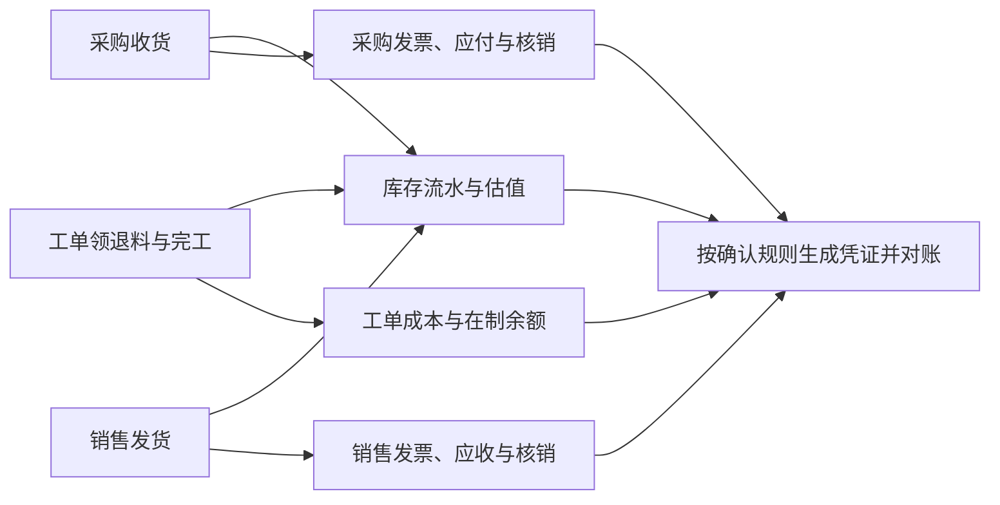

# 衡序 ERP 需求分析文档

- 工程名：衡序 ERP（`hengxu-erp`）
- 输入：[ERP 构建预备文档](ERP构建预备文档.md)第 2–7 节
- 状态：从零建设的 ERP 试点需求基线。首期先贯通进销存和样板账务，再验证简单装配。企业现状、容量与成本数字待样板验证。

## 1.1 项目愿景

**一句话愿景**：让仓库、销售、生产和财务用同一套单据对清货、款和成本。

原文描述了两个首期值得验证的场景。它们是待验证的业务痛点，实际发生频次和损失需由样板企业提供。

| 谁遇到问题 | 场景 | 损失或影响 | 需要的现状证据 |
| --- | --- | --- | --- |
| 仓管、采购、会计 | 订单分批到货、中途退货、多次付款 | 手工拼接单据才能确认应付、未交和已核销余额，差异追查耗时 | 一组脱敏订单、收退货、发票和付款记录，记录对账时间及差异 |
| 销售、仓管 | 一笔订单同时包含外购商品和自产成品，分批发货 | 预留、现存和可用量混用时会影响交付承诺 | 一张混合销售订单及各行的预留、出库记录 |
| 生产、成本会计 | 工单分批完工，最终结算前部分成品已发出 | 暂估成本与实际成本发生差额时，完工与销售成本难以核对 | 一张含领退料、部分完工出库和完工差异的工单 |

**ROI 演算**。以采购、销售和生产三类人工核对合计每月 240 次、每次少花 5 分钟、每小时全成本 80 元为例，月度可节省 20 小时，折算 1,600 元。若新增运维为每月 500 元、一次性实施投入 30,000 元，首年 ROI 为 `[(1,600 − 500) × 12 − 30,000] ÷ 30,000 = −56%`。以上数字为演算假设。上线前以样板企业两周抽样的实际件数和计时、企业提供的岗位成本，以及技术团队的实施和运维估算替换。

## 1.2 需求规格

**首期已确认范围**。单法人、人民币、多仓库。先做采购与销售各自贯通库存和往来，再用一张装配工单验证共用底座。默认禁止负库存，移动加权平均保留为候选口径。计价与舍入、业务过账时点、退货差额和期间规则交由业务与财务确认。

采购、销售和制造共用库存。单据行负责追溯来源，账簿变动由 ERP 的业务权限和规则控制。

| 编号 | 功能 | 输入 | 处理 | 输出与验收 | 优先级 |
| --- | --- | --- | --- | --- | --- |
| FR-01 | 档案与权限 | 公司、仓库、物料、往来对象、岗位 | 维护档案，校验岗位和数据范围 | 采购员只能处理其授权范围内的单据。尝试以越权账号读取测试仓库库存时拒绝并留痕 | 必须 |
| FR-02 | 分批采购与应付 | 100 件采购订单、分批收货、10 件退货、90 件发票、两次付款 | 按来源行累计收退、匹配发票并分配核销金额 | 净收 90 件，应付对应 90 件，按固定样本金额核对未开票、未核销余额及来源行 | 必须 |
| FR-03 | 销售履约与应收 | 同时含外购件与自产件的销售订单，发货、发票和部分收款 | 预留并分批出库，按行累计履约，按金额核销 | 商品累计发出 30 件时，FR-02 的同商品在无其他变动时剩 60 件。核对两类物料各自的预留、可用及应收余额 | 必须 |
| FR-04 | 库存控制 | 出入库、调拨、盘点、并发发货请求 | 形成可追溯流水，按仓库核对现存量与预留量，事务内检查可用量 | 可用量为 1 时，两笔各出 1 的并发请求最多成功一笔。同一调拨单可追到两侧库存流水 | 必须 |
| FR-05 | 装配工单 | 锁定版本的 BOM、工单 10 件、领料 23、退料 1、完工 6 与 4、人工和制造费用 | 归集工单成本，跟踪分批完工和结算差额 | 净耗 22、用量差异 2。包含已出库成品的差额能追到来源，按样板口径全部结转后在制余额为 0 | 必须 |
| FR-06 | 过账、更正与对账 | 已确认的业务动作、过账规则、期间、冲销请求 | 校验借贷平衡和期间，重复动作去重，更正保留原单反向链 | 同一动作重试只产生一组有效过账记录。账期间关闭后拒绝越期过账。库存估值和往来明细按认可的同一时点与总账核对 | 必须 |
| FR-07 | 查询与下钻 | 订单、库存、账龄和工单筛选条件 | 权限过滤，按确定口径汇总并关联来源 | 指标可下钻到授权单据行，样本合计与底表一致 | 应有 |
| FR-08 | 首次启用与期初 | 样板公司、首个会计期间、基础档案、期初库存数量与金额、往来及科目余额 | 按公司和期间导入经签认的批次，验证来源、借贷和控制科目，确认后锁住已启用的期初批次 | 可从空库初始化样板账套。库存、应收、应付子账与总账期初一致，重复提交无额外期初记录 | 必须 |

**容量与非功能目标**。试点建议以 30 个并发活跃用户、10 万单据行、50 万库存流水行、单据最多 200 行为压测假设。以上容量根据样本规模调整。ERP 性能、可用性和隔离的数值与测量办法见 1.4。

**首期范围边界**。有限产能排程、配方与联副产品、跨公司合并、多币种、薪酬和固定资产留待后续验证。正式开票、银行接口、期初迁移、法定报表责任待确认。样板账套可以录入期初，但历史单据批量迁移和外部系统对接列为后续工作。

| 依赖或异常 | 降级动作 | 返回和提示 |
| --- | --- | --- |
| ERP 数据库不可用或提交结果未知 | 提交失败时保留原有状态。结果未知时按来源动作 ID 查询，使用同一 ID 安全重试 | 显示“提交结果待确认”，提供查询或重试入口 |
| 过账或查询工具失败、权限不足 | 过账失败交由事务回滚或依动作 ID 核实。权限不足时终止该请求 | 返回操作编号和可重试状态，或权限不足提示 |

## 1.3 用户画像与场景矩阵

| 角色 | 技术熟练度假设 | 频率假设 | 核心诉求 |
| --- | --- | --- | --- |
| 采购、销售业务员 | 熟悉单据和表格 | 每日 | 查看订单待交、已票和往来状态 |
| 仓管 | 熟悉仓储操作 | 每日 | 及时区分现存、预留和可用数量 |
| 生产计划员、领料员 | 熟悉 BOM 和工单 | 每批生产 | 知道缺料、净耗和可完工量 |
| 会计、出纳 | 熟悉凭证、核销和对账 | 每日或结账期 | 对清往来、成本和凭证，追溯源单 |
| 业务主管 | 熟悉经营指标 | 每周或按需 | 追查库存、履约和成本异常 |

| 场景编号 | 用户画像 | 输入示例 | 期望输出 | 成功判据 |
| --- | --- | --- | --- | --- |
| S01 | 采购员与会计 | 购 100、分次收完、退 10、开票 90、两次付款 | 净收及其与发票、两笔付款的关联 | 净收等于 90，同样本应付和核销金额与人工账单一致（FR-02） |
| S02 | 销售员与仓管 | 同一订单含外购与自产件，外购件分批发出 30 | 订单行履约、剩余库存与应收余额 | 外购件现存量等于 60，预留与余额按固定样本逐行对平（FR-03） |
| S03 | 仓管 | 两笔各扣 1 件的并发出库，仅余 1 件 | 一笔出库成功与另一笔缺货反馈 | 可用量始终非负，两次请求最终只形成一笔出库（FR-04） |
| S04 | 生产人员与成本会计 | 领料 23、退料 1、完工 6 与 4，第二批完工前首批部分出库 | 工单耗用、差异和成本来源 | 净耗为 22，超用 2，全部结转后在制余额为 0，差额可追溯（FR-05） |
| S05 | 会计与业务主管 | 重试过账、冲销、查询报表及尝试越权下钻 | 唯一过账、更正记录、来源链与访问拒绝 | 账实按预期样本一致，每笔可追溯，越权样例全部被拒绝（FR-01/06/07） |
| S06 | 系统管理员与会计 | 空库创建样板公司，录入期初库存及应收应付 | 可登录的账套、期初流水与对账结果 | 期初库存与往来均和总账对平；错误期初整批拒绝，重试不会重复入账（FR-08） |

## 1.4 成功指标

下表均为拟议试点目标。前三类业务核对按同一计时定义纳入 1.1 的 ROI，其他质量指标独立验收。

| 指标名 | 目标值 | 测量方法 | 采样频率 |
| --- | --- | --- | --- |
| 人工核对单次平均用时变化 | 较试点基线减少至少 5 分钟 | 同类同复杂度的样本，按现有流程与 ERP 操作配对计时。合计省时 = 各类差值 × 当月件数 | 基线两周，试点每周抽样 30 件，月度汇总 |
| 样本对账一致率 | 100% | 按样板财务签认的预期结果逐条核对库存估值、往来和总账 | 每次版本验收及每次模拟结账 |
| 重复过账、越权、并发导致负库存 | 0 起 | 回放冲销与幂等用例，执行权限矩阵和库存并发测试，并检查已提交记录 | 每次版本验收 |
| ERP 响应 | 30 个并发活跃用户下，库存列表读取 P95 ≤ 1 秒，库存动作过账 P95 ≤ 2 秒 | 用 1.2 的数据量压测，分端点计量 | 每次候选版本 |
| 试点业务时段可用性 | 每月 ≥ 99.5% | 每分钟对登录、查询和受控写入探测，成功分钟数 ÷ 业务分钟数 | 每分钟采集，月度统计 |

## 1.5 参考实例调研

2026-11-15 核对 GitHub 公共仓库。ERP 核心检索使用 `ERP inventory manufacturing accounting`，并使用 `site:github.com`、`stars:>200`、`pushed:>2025-01-01` 缩小范围，再核对 Star、最近三个月提交、README 部署或演示入口及许可证。

| 项目名 | 链接 | Star | 最近 commit | 核心架构 | 技术栈 | 可复用点 | 不适用点 |
| --- | --- | --- | --- | --- | --- | --- | --- |
| ERPNext | [仓库](https://github.com/frappe/erpnext) | 41,310 | [2026-11-15](https://github.com/frappe/erpnext/commit/20e859ef601ba907327ddb47e6286fdbba02f354) | 统一业务文档框架上的采购、库存、制造与财务 | Frappe、Python、JavaScript、MariaDB | 跨模块的业务验收样本设计 | Frappe 框架及数据库依赖与衡序初选不同，GPL-3.0 项目用作设计参考 |
| Odoo Community | [仓库](https://github.com/odoo/odoo) | 55,809 | [2026-11-15](https://github.com/odoo/odoo/commit/9d233dca4156d58ca573e9cdc3b32327c97aa282) | 可单独启用且互相集成的业务应用 | Python、PostgreSQL、Odoo ORM 与 Web 客户端 | 业务模块启用边界和跨模块用例 | Odoo ORM 与 UI 属于自身生态，许可证以[仓库 LICENSE](https://github.com/odoo/odoo/blob/20.0/LICENSE)为准 |
| Dolibarr | [仓库](https://github.com/Dolibarr/dolibarr) | 7,874 | [2026-11-15](https://github.com/Dolibarr/dolibarr/commit/98d05ecc5c9c504fc51a4acca81baf97ce5e6831) | ERP/CRM Web 应用按模块启用 | PHP、MariaDB/MySQL 或 PostgreSQL | 中小企业按需启用模块，以及采购、库存、发票的轻量试点 | PHP 技术栈与衡序初选不同，GPL-3.0 项目用作设计参考 |

- **ERPNext 对衡序的启示**。其公开功能说明覆盖订单、制造和财务。衡序可用同一张混合销售订单验证外购件和自产件能否进入同一个交付与财务口径，并把这个联测放进 FR-03 验收。 [仓库功能及部署说明](https://github.com/frappe/erpnext#readme)
- **Odoo 对衡序的启示**。其应用可分别启用并集成。衡序可据此明确制造启用的验收条件，制造关闭时商贸链路可独立运转，启用后完工品复用既有销售发货和往来能力。 [仓库 README](https://github.com/odoo/odoo#readme)
- **Dolibarr 对衡序的启示**。其按需启用模式适合用来约束首期菜单与岗位授权。衡序可先让采购、销售、仓管、会计走完整链路，再向装配岗位开放 BOM 和工单。 [仓库 README](https://github.com/Dolibarr/dolibarr#readme)

## 1.6 试点规则与签收

| 事项 | 首期口径 | 签收证据 |
| --- | --- | --- |
| 业务顺序 | 先贯通采购、销售、库存与财务，再验证一条简单装配链路 | 采购、销售、仓库和财务分别签认闭环，随后由生产和成本会计签认工单 |
| 首次启用 | 从空库建账并验证期初 | 样板期初清单、校验错误样本与账簿对照 |
| 账务用途 | 用单法人、人民币样板账套验证过账、核销与对账 | 样板科目、期初数据、过账触发表、预期凭证与业务对账表 |
| 报表边界 | 试点交付库存估值、往来明细、凭证明细及试算结果；销售毛利、工单差异按样板验证 | 统一截止时点、来源行下钻和对照表 |
| 样本与规则待确认 | 样板企业、仓库与岗位范围、单位换算及批次要求、计价精度、正式上线责任 | 样板业务负责人和财务签认，未定项保留在可行性分析清单 |

试点验收需要可重复的测试数据与期望结果。[架构与技术实现文档](架构与技术实现文档.md)给出状态、边界和过账设计，[可行性分析文档](可行性分析文档.md)给出可执行样本、度量方式和阶段准入条件。
